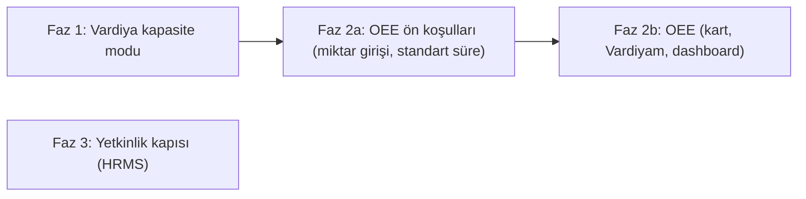

# Shopfloor Geliştirmeleri: Vardiya Kapasite Modu, OEE ve Yetkinlik Kapısı — Tasarım

- **Durum:** Faz 1 onaya hazır · Faz 2 ön koşul sorularını bekliyor · Faz 3 taslak
- **Tarih:** 2026-11-12 (bağımsız builder kontrolünden sonra revize edildi)
- **Modül:** `erpnextkta/kta_calisma_karti`

## 1. Amaç ve Neden

`kta_calisma_karti` bugün operatör için sade bir dijital iş kartı ve veri toplama terminali olarak iyi çalışıyor. Hedef onu bir shopfloor/MES aracına yaklaştırmak. Bu tasarım üç konuyu kapsıyor:

1. **Şeffaf süre verisi.** Mevcut algoritma operatörün vardiya içindeki net süresini 430 dakikada kesiyor. Sonuç olarak raporlarda herkes tam 430 dk çalışmış gibi görünüyor. Kullanıcı bu kesmeyi ayarlardan kapatmak, kontrolü operatöre bırakmak ve operatörün gerçekte ne yaptığını görmek istiyor.
2. **Gerçek OEE.** Mevcut dashboard faaliyet ve meşguliyet takibi yapıyor. Hız kaybını ölçmüyor ve Kullanılabilirlik × Performans × Kalite skorunu üretmiyor.
3. **Yetkinlik kapısı.** Eğitimi olmayan operatörün kritik bir operasyonda kart başlatması engellenecek. Bunun için HRMS'teki hazır veri modeli kullanılacak.

Kullanıcının ayrıca açık bir şartı var: **Operatör kendi performansını görebileceği ayrı bir bölüme sahip olmalı.** Kart detay ekranı tek bir karta ait olduğu için bu bölüm orada olmayacak.

## 2. Mevcut Durum (koddan doğrulandı)

### 2.1 Süre algoritması

| Kural | Nerede | Davranış |
|---|---|---|
| Vardiya kapasite sınırı | `calisma_karti.py`: `hesapla_toplam_sure`, `_calculate_remaining_shift_capacity`, `get_kta_settings` | `net = min(toplam − duruş, max_kart_suresi_dk·60 − aynı vardiyadaki diğer kartların neti)`. Varsayılan sınır 430 dk. |
| Vardiya penceresi | `_shift_window`, `_shift_name_by_now` | Geçerli vardiya kodda sabit 00/08/16 sınırlarıyla seçilir. Başlangıç ve bitiş saatleri HRMS `Shift Type` kaydından okunur. Sınır anı biten vardiyaya sayılır. Gece vardiyası +1 güne taşınır. |
| Reddedilen kart muafiyeti | `_other_cards_net_seconds_in_shift` | `kalite_kontrol = "Reddedildi"` olan kartlar kotaya sayılmaz. Fonksiyon `FOR UPDATE` kilidi alır. |
| Canlı duruş | `_calculate_total_durus_seconds` | Açık duruşun `now` anına kadar geçen süresi net süreden düşülür. |
| Job Card aktarımı | `api_impl/job_card_sync.py` | Time log'a `to_time = başlangıç + net` yazılır. `completed_qty = 0` gönderilir. |
| Vardiya sonu kapatma | `tasks.auto_close_timed_out_cards`, cron `15 0,16 * * *` | Yalnızca **16:00 ve 00:00** vardiya sonlarında açık kartları kapatır. 08:00 (3. vardiya sonu) için kapatma yoktur; 3. vardiyada açık kalan kart 16:00'ya kadar açık kalır. |
| Zorla yazma | `tasks.py` (auto_close), `api_impl/cards.py` `islem_yap` ve `_auto_pause_other_active_cards` | Submit edilmiş kartlarda süre alanları `frappe.db.set_value` ile ayrıca yazılır. Çalışan kartlar zaten submit edilmiş durumdadır (`docstatus = 1`). |
| Uyarı | `validate` ve `view-calisma-karti/App.vue` | `kart_uyari_suresi_dk` (400) aşılınca uyarı verilir. Bu uyarı kartı kesmez. |

### 2.2 OEE için gereken veriler — mevcut durum

- **Üretilen miktar pratikte hiç girilmiyor.** Backend `islem_yap(..., tamamlanan_miktar)` parametresini kabul ediyor. Ancak arayüz Bitiş'te `callIslem("Bitis", null, null, 0)` gönderiyor (`App.vue:217`). Duruş çağrısı ise miktar göndermiyor (`App.vue:193`). Sonuç olarak `tamamlanan_miktar` değeri 0 kalıyor.
- **Standart süre kaynağı yok.** Job Card `time_required` alanı yalnızca kapasite planlama açıkken, `scheduled_time_logs` toplamı olarak doluyor (`job_card.py:733-757`). Bu değer Work Order operasyonunun toplam süresinden geliyor; bölünmüş Job Card'ların her biri tam süreyi alıyor. KTA'da `disable_capacity_planning = 1` için ayrı bir override bulunması, kapasite planlamanın kapalı olduğunu ve alanın büyük olasılıkla 0 olduğunu gösteriyor.
- **Bir Job Card'a birden çok KTA operasyonu bağlanabiliyor** (`api_impl/create.py` `get_operations_for_job_card`). Bu yüzden Job Card düzeyindeki bir parça başı standart süre, KTA kartı için yanlış olabilir.
- **Hurda tablosu** (`Calisma Karti Hurda`) operasyon malzemesi hurdası tutuyor, bitmiş parça reddini tutmuyor.
- **Duruş tipi:** `KTA Durus Sebebi.durus_tipi` ∈ {Plansız, Planlı, Sistem, Ürün Geçişi / Hazırlık}. Otomatik duraklatma ve zaman aşımı sebepleri "Sistem" tipinde tanımlanmış.
- **Workstation:** `production_capacity` alanının etiketi "Job Capacity"; paralel iş sayısını tutuyor, hız bilgisi değil. Workstation OEE'de yalnızca gruplama boyutu olarak kullanılacak (`is_istasyonu`). *Not: Konuşmada "Workstation'dan hız alınır" dedim; bu yanlıştı.*

### 2.3 Net süre için iki farklı tanım

- **430 kotası:** Vardiya penceresi `baslangic_saati` üzerinden belirleniyor, reddedilen kartlar dahil edilmiyor.
- **Dashboard** (`tum_operatorler_net_sure`) **ve günlük hata raporu:** Gruplama takvim günüyle (`DATE(baslangic_saati)`) yapılıyor, reddedilen kartlar dahil ediliyor.

### 2.4 HRMS yetkinlik modeli

Mevcut doctype'lar: `Skill`, `Employee Skill Map` (`employee` unique, `employee_skills` tablosu), `Employee Skill` (`skill`, `proficiency` [Rating], `evaluation_date`).

## 3. Hedefler, Kapsam Dışı, Anti-hedefler

**Hedefler**
- G1. Vardiya kapasite sınırı ayarlardan tek bir check ile kapatılabilecek. Kapalıyken net süre kesilmeyecek.
- G2. Sınır açıkken bile kesmeden önceki fiili net süre raporlanabilecek (mevcut alanlardan türetilir, bkz. §5.2).
- G3. Kart bazında A × P × Q = OEE hesaplanacak.
- G4. Operatör kendi vardiyasını kart listesi ekranında görecek.
- G5. Yönetici dashboard'una istasyon bazlı OEE ve kayıp dağılımı eklenecek.
- G6. Gerekli yetkinliği olmayan operatör kart başlatırken uyarılacak veya engellenecek.

**Kapsam dışı**
- PLC/sensör, Andon, lot şeceresi, dijital talimat.
- Formen barkoduyla refakatli başlatma.
- Geçmiş kartların OEE'sinin hesaplanması.

**Anti-hedefler**
- Deploy sonrasında ayar hiç kaydedilmemişken 430 dk davranışının sessizce değişmesi.
- Operatörün Vardiyam sayacı ile amir raporunun farklı sayılar göstermesi.
- Toplu OEE'nin yüzdelerin ortalaması alınarak hesaplanması.
- Miktar veya standart süre yokken performansın uydurulması.

## 4. Fazlar



Her faz kendi uygulama planı ve kendi PR'ı ile ilerleyecek. Faz 3 diğer fazlardan bağımsız.

## 5. Faz 1 — Vardiya Kapasite Sınırı Ayarı

### 5.1 Davranış

**Yeni ayar.** `KTA Calisma Karti Settings` içine bir Check eklenir:
- Alan adı `vardiya_kapasite_sinirini_devre_disi_birak`, etiket "Vardiya Kapasite Sınırını Devre Dışı Bırak", varsayılan 0. Yeri `kart_uyari_suresi_dk` alanının hemen altı.
- **0 (varsayılan / hiç kaydedilmemiş):** Bugünkü davranış aynen devam eder.
- **1:** `net_calisma_suresi = max(0, toplam − duruş)` olur. Kesme uygulanmaz ve `_other_cards_net_seconds_in_shift` (kilitli sorgu) çağrılmaz.

**Kartlarda yeni alan yok.** Bkz. §5.2.

**Değişmeyen davranışlar.**
- `max_kart_suresi_dk` her iki modda da kalır. Serbest modda hedef anlamı taşır.
- `kart_uyari_suresi_dk` uyarısı iki modda da çalışır.
- Serbest modda Job Card'a gerçek net süre aktarılır.
- Süre alanlarının `db.set_value` ile zorla yazıldığı yerler (`tasks.auto_close_timed_out_cards`, `cards.islem_yap`, `cards._auto_pause_other_active_cards`) değişmez; `net_calisma_suresi`'yi zaten yazıyorlar.

**Vardiya sonu otomatik kapatma bu ayardan etkilenmez** (benim önerim, Açık Soru 6).

**Mod değişimi.** Kapalı kartlar yeniden hesaplanmaz. Açık kartlar bir sonraki kaydetmede yeni moda göre hesaplanır.

### 5.2 Ham net süre: ayrı alan değil, türetilmiş değer

Kesilmeden önceki fiili net süre ayrı bir alanda saklanmaz. Kapanmış kartta açık duruş kalmaz (otomatik kapatma bile son duruşu kapatır), bu yüzden değer mevcut alanlardan birebir hesaplanır:

- `ham_net = parse(toplam_sure) − parse(toplam_durus)` (0'ın altına düşerse 0)
- `kesilen = ham_net − parse(net_calisma_suresi)`

Açık kartta her iki değer de zaten anlık (`now` ile) hesaplanıyor.

*Neden ayrı alan yok:* Alan, kartta zaten bulunan bilgilerin bir kopyası olurdu. Ayrıca üç zorla yazma noktasında ayrıca güncel tutulması, bir backfill patch'i ve migrate gerekirdi; bir noktanın unutulması eski değerin ekranda kalmasına yol açardı (kullanıcı geri bildirimiyle kaldırıldı).

Raporlar ve Faz 2 bu iki formülü kullanmak için tek bir yardımcı fonksiyon paylaşır (Faz 2'de `api_impl/oee.py` içinde tanımlanır).

### 5.3 Neden ters mantıklı ("devre dışı bırak") bir check?

Frappe Single dokümanında hiç kaydedilmemiş bir Check alanı için `get_single_value` 0 döner. Alan "Sınırı Uygula" (varsayılan 1) olarak tanımlansaydı, ayarlar kaydedilene kadar canlı sistemde sınır sessizce kapanırdı. Ters mantık sayesinde migrate patch'ine de gerek kalmaz.

### 5.4 Dokümantasyon ve çeviri

- `docs/kta_calisma_karti_ayarlar_rehberi.md` ve `erpnextkta/www/docs/calisma-karti-ayarlar.html` güncellenir.
- Bu dosyalardaki `max_kart_suresi_dk` açıklaması koda uymuyor ("bir kartın en fazla açık kalma süresi, cron duraklatır"). Gerçek davranış "operatörün vardiya net kotası" olduğu için açıklama da düzeltilir.
- Yeni metinler `translations/en.csv` ve `de.csv` dosyalarına eklenir.

## 6. Faz 2 — OEE

### 6.1 Ön koşullar (Faz 2a — sorular yanıtlanınca netleşecek)

- **Miktar girişi:** Operatör Bitiş'te üretilen adedi girmeli (Açık Soru 1). Kalite çarpanı için gerekirse hatalı adedi de girmeli.
- **Standart süre kaynağı:** KTA operasyonu × ürün düzeyinde, parça başı saniye cinsinden bir standart süre gerekli (Açık Soru 2).

### 6.2 Formüller (kart bazında)

- `planlı_kayıp` = `durus_tipi` ∈ {Planlı, Sistem} olan duruşların toplamı.
- `planlanan` = `toplam − planlı_kayıp`
- **A** = `ham_net / planlanan` (`ham_net` §5.2'deki türetilmiş değer)
- **P** = `(adet · ideal_sn) / ham_net`. P > 1 ise OEE hesabında 1'e kırpılır; ham değer "standart süreyi gözden geçirin" uyarısıyla saklanır.
- **Q** = `sağlam / (sağlam + hatalı)`
- **OEE** = `A · P · Q`
- `ideal_sn` veya `adet` yoksa P ve OEE **None** olur; arayüzde "Veri yok" gösterilir.
- **Toplama** (vardiya, istasyon, gün): pay ve payda ayrı ayrı toplanır, oran en sonda alınır.

### 6.3 Yapı (benim önerim)

- **Backend:** `api_impl/oee.py` saf fonksiyonlar içerir. Whitelisted uçlar `get_card_oee(docname)` ve `get_my_shift_summary()`. Vardiya penceresi ve kota için `calisma_karti.py`'deki mevcut fonksiyonlar kullanılır.
- **Kart ekranı:** O karta ait hız/OEE, `CkChips` içinde bir çip olarak gösterilir.
- **Vardiyam bandı:** `list-calisma-cards` ekranının üstünde, açılıp kapanabilen yeni `CkShiftSummary.vue` bileşeni.

```text
┌ Vardiyam — 1. Vardiya ─────────────────────────────── [▾] ┐
│ Net: 4 sa 52 dk / 7 sa 10 dk  ███████████░░░░░  %68        │
│ Hız: %92   Kalite: %99   Kart: 3   Duruş: 55 dk            │
└────────────────────────────────────────────────────────────┘
```

- **Snapshot alanları:** `oee_*` Percent alanları, `allow_on_submit`. Değerler Bitiş'te yazılır ve kalite sonucu sonradan değiştiğinde yeniden hesaplanır (QI submit'i ve alt operasyon durumu çoğu zaman Bitiş'ten sonra geliyor).
- **Dashboard:** "Ortalama OEE" number card, "İstasyon Bazlı OEE", "Kayıp Dağılımı" ve "Kesilen Süre" (`ham − net`, operatör bazında).

## 7. Faz 3 — Yetkinlik Kapısı (HRMS)

- **Kaynak:** HRMS `Employee Skill Map`.
- **Gereksinim tanımı** *(benim önerim):* `KTA Calisma Karti Operasyonlari` içine "Gerekli Yetkinlikler" child tablosu eklenir (`skill`, `min_seviye` 1–5). Tablo alanı `allow_on_submit` olur, çünkü doctype submittable; amend edilirse isim değişir ve kartlardaki bağlantılar kopar.
- **Seviye:** Frappe v14+ `Rating` değerini 0–1 arası saklar. Karşılaştırma `round(proficiency · 5) >= min_seviye` ile yapılır. Kurulumdaki gerçek değer, uygulamaya başlamadan önce doğrulanmalı.
- **Kapı noktası:** Kart oluşturma ve `Baslat`.
- **Mod:** Kapalı / Esnek (uyar) / Sıkı (engelle). Varsayılan Kapalı.
- **Opsiyonel:** "Yetkinlik Geçerlilik Süresi (Ay)" ayarı; 0 süresiz anlamına gelir.

## 8. Değerlendirilen Yaklaşımlar

| Karar | Seçenekler | Seçilen ve gerekçe |
|---|---|---|
| Kapasite ayarı | (a) "Devre Dışı Bırak" check'i, varsayılan 0 · (b) Select · (c) "Uygula" check'i, varsayılan 1 | **(a).** (c), ayar kaydedilmemiş bir Single'da sınırı sessizce kapatır. (b) patch ve ek metin gerektirir. |
| Ham süre | Ayrı alanda sakla · mevcut alanlardan türet | **Türet** (kullanıcı geri bildirimi). `toplam_sure − toplam_durus` kapanmış kartta birebir aynı değeri verir; ayrı alan kopya veri, üç zorla yazma noktası ve backfill patch'i getirirdi. |
| Standart süre | Job Card `time_required` · Work Order / BOM operasyon süresi · KTA operasyonu × ürün | **Henüz karar verilmedi** (Açık Soru 2). Job Card seçeneği elendi: alan kapasite planlama kapalıyken boş kalıyor ve birden çok KTA operasyonu arasında bölünemiyor. |
| Operatör bölümü | Kart detayı · liste bandı · çekmece | Kart detayını **kullanıcı reddetti.** Liste bandı **benim önerim.** |
| Yetkinlik verisi | HRMS · yeni doctype | **HRMS** (kullanıcının önerisi). |

## 9. Kararlar

**Kullanıcının kararları:** 430 algoritmasını kapatan bir check eklenecek ve kontrol operatöre bırakılacak. Kartlara yeni süre alanı eklenmeyecek; ham net süre türetilecek. Operatörün bir performans bölümü olacak, ancak kart detay ekranında olmayacak. Yetkinlik için HRMS Skill Map kullanılacak. OEE mevcut süre algoritmasıyla uyumlu olacak.

**Benim önerilerim:** Ters mantıklı check. Serbest modda da otomatik kapatmanın sürmesi. "Sistem" duruşlarının planlı kayıp sayılması. P > 1 değerinin kırpılması. Snapshot alanları ve kalite değişince yeniden hesaplama. Liste bandı. Yetkinliğin KTA operasyonunda tanımlanması.

## 10. Açık Sorular

1. **(Faz 2a) Üretilen ve hatalı adet nereden gelecek?** Bugün Bitiş'te adet sorulmuyor. Önerim: Bitiş diyaloğunda "Üretilen Adet" zorunlu, "Hatalı Adet" opsiyonel olsun.
2. **(Faz 2a) Bir parçanın bir KTA operasyonunda ne kadar sürmesi gerektiği bugün nerede tutuluyor?** (BOM operasyon süresi, bir Excel, ustaların bilgisi…) Standart süre bu yanıta göre tasarlanacak.
3. **(Faz 2b) Vardiyam hangi net süre tanımını kullanacak?** Önerim: 430 kotasının tanımı (vardiya penceresi, reddedilenler hariç), çünkü hedef bu kotaya göre konuyor. Mevcut günlük chart'lar olduğu gibi kalabilir ama etiketleri "takvim günü" olarak netleştirilmeli.
4. **3. vardiya (00:00–08:00) çalışılıyor mu?** Çalışılıyorsa 08:00 için otomatik kapatma eksik. Bu eksiklik serbest modda 16 saatlik kartlar üretebilir.
5. **(Faz 2) BOM/Routing süreleri** — 2. soruya bağlı.
6. **(Faz 1) Serbest modda vardiya sonu otomatik kapatma kalsın mı?** Önerim: kalsın.

## 11. Builder'a Bırakılanlar

- Fonksiyon bölme ve isimlendirme (proje kuralı: ~10 satır).
- Test kurulumu: `KTATestCase` ve `make_mock_calisma_karti` deseni izlenecek.
- Chart tipleri.
- Vue bileşenlerinin iç yerleşimi. Proje kuralları geçerli: `__()`, Title Case, cümle bölmeme.
