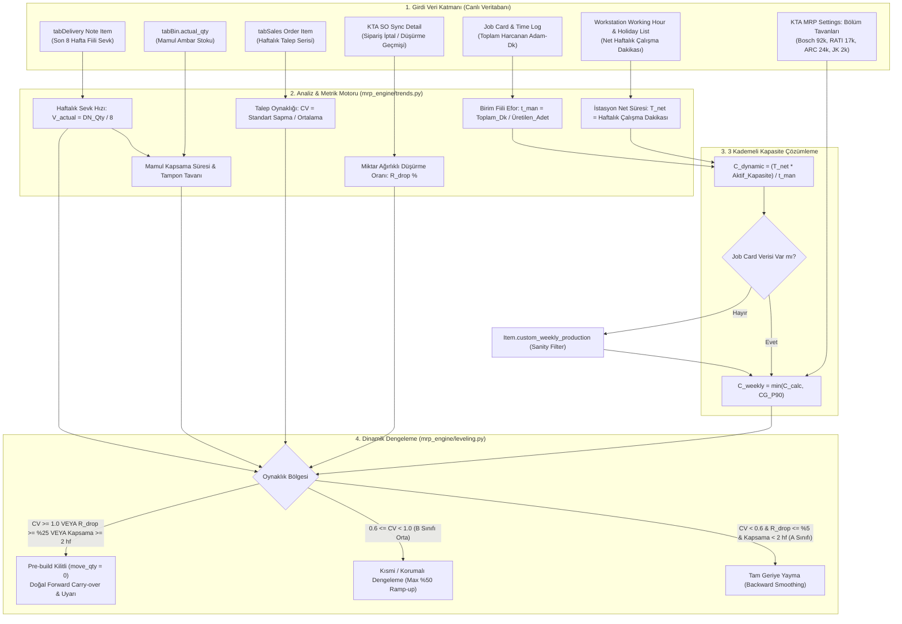

# Design Document: Dynamic Trend-Based Capacity Leveling & Smoothing (Dinamik Trend ve Talep Oynaklığı Bazlı Kapasite Dengeleme)

**Tarih:** 2026-11-14  
**Durum:** Onaylandı & Reviewer Check Tamamlandı  
**Kapsam:** `erpnextkta/kta_mrp/mrp_engine/`, `erpnextkta/kta_sales/`, `KTA MRP Settings`, MRP Raporu ve Simülasyon Paneli

---

## 1. Intent and The Why (Gerekçe ve Amaç)

### Mevcut Durum ve Saha Bulguları (Canlı Veritabanı Analizleri)
Canlı üretim veritabanındaki 5.082 adet tamamlanmış İş Emri, 2026 yılındaki tüm fiili sevkiyatlar ve Çalışma Kartı (Job Card Time Log) dökümleri üzerinde yapılan derinlemesine analizler sonucunda şu operasyonel gerçekler ortaya çıkarılmıştır:

1. **Termin ve Çizelgeleme Kırılganlığı (%67.3 Gecikme):**
   * İncelenen 5.082 iş emrinin **%67.3'ü (3.418 iş emri)** planlanan teslim tarihinden sonra gecikmeyle tamamlanmaktadır.
   * Özellikle Rational grubunda iş emirleri ortalama **+10 ila +15 gün gecikmeli** bitmektedir.
   * Bunun sebebi operatörlerin yavaş çalışması değil; siparişlerin teslimat haftasına yığılarak iş emirlerinin son dakikada açılması, hammadde bekleme kuyrukları ve **Geriye Dönük Dengeleme (Backward Smoothing)** eksikliğidir.
2. **Kapasite Veri Girişi Tutarsızlıkları (Uçurumlar & Gizli Runner'lar):**
   * Bazı ürünlerde şablon olarak `84.000/hf` gibi uçuk kapasiteler girilmiş (oysa haftalık sevk 50-100 adettir).
   * Bazı hızlı satan modellerde (örneğin Rational `40.08.457` haftalık 54 adet sevk edilirken) kapasite **0 (tanımsız)** bırakılmıştır.
   * Standart bir MRP algoritması 84.000'i görünce fabrikayı sonsuz kapasiteli zanneder, 0'ı görünce kapasite denetimini tamamen devre dışı bırakır.
3. **BOM ve Operasyon Standart Dışılığı:**
   * Ürün ağaçları (BOM) mühendisler arasında homojen açılmamıştır. Örneğin `8750301805`'te Kesim, Montaj, Enjeksiyon ve Test 4 ayrı operasyon olarak tanımlıyken; benzer bir Bosch ürünü olan `8705902372`'de Enjeksiyon ve Test operasyonları BOM'da bulunmamakta, Montaj operasyonunun içinde eritilmektedir.
   * Dolayısıyla spesifik bir operasyon adına (örn. "Test" veya "Enjeksiyon") bağımlı bir kapasite hesabı çökmeye mahkûmdur.
4. **Müşteri Talebinin Karakteristik Ayrımı (Bosch vs Rational/JK):**
   * Bosch müşterisinde CV > 1.0 ve tek kalemde -100k ila -500k adetlik testere dişi sipariş iptalleri/düşüşleri yaşanırken (R_drop >= %25),
   * Rational ve JK müşterilerinde sipariş iptali neredeyse sıfırdır (R_drop <= %2), sürekli net sipariş artışı vardır ancak rafta kronik sıfır stokla (JIT) çalışılmaktadır.

### Amaç
MRP motoruna; gelen sipariş oynaklığını (CV), sipariş iptal riskini (R_drop), Müşteri Grubu (Bölüm) kanıtlanmış kapasite tavanını (P90) ve sahadaki fiili toplam çalışma kartı eforunu harmanlayan **3 Kademeli Dinamik Hibrit Kapasite ve Dengeleme Motoru** kazandırmaktır.

---

## 2. Goals, Non-Goals, and Anti-Goals

### Goals (Hedefler)
- **Modüler Açılıp Kapatılabilirlik:** `KTA MRP Settings` üzerinden `enable_dynamic_trend_smoothing` anahtarıyla tek tıkla açılıp kapatılabilmelidir. Kapalıyken mevcut statik motor %100 aynı sonuçları üretmelidir.
- **3 Kademeli Dayanıklı Kapasite Hesabı (Robust Triad):**
  1. *Mikro:* Operasyon adlarından bağımsız toplam fiili adam-dakika (t_man) * İstasyon net çalışma süresi (`tabWorkstation Working Hour` ve `Holiday List`) * Aktif istasyon sayısı.
  2. *Meso:* İş kartı yoksa `Item.custom_weekly_production` fallback'i (0 ve uç değerler filtrelenir).
  3. *Makro:* Müşteri Grubu kanıtlanmış P90 tepe hacmi (Bosch ~92k, Rational ~17k, Arçelik ~24k, JK ~2k) üst sınır olarak kırpar.
- **A Sınıfı Runner Dengelemesi (Backward Smoothing):** CV < 0.6 ve R_drop <= %5 olan kararlı ürünlerde teslimat haftasındaki kapasite aşımı, önceki boş haftalara yayılarak %67'lik iş emri gecikmeleri önlenmelidir.
- **Testere Dişi ve Overstock Freni:** CV >= 1.0 veya R_drop >= %25 olan ya da ambar kapsama süresi > 2.0 hafta olan ürünlerde erken üretim kilitlenmelidir (move_qty = 0).
- **Anti-Gasping Feasible Delivery:** Yetişmeyecek terminler 1. haftanın planını bozmayacak, fiziki teslimat projeksiyonu hesaplanacaktır.

### Non-Goals (Kapsam Dışı)
- ERPNext'in hantal "makine kuyruğu" sonlu çizelgeleme (finite scheduling) yapısına dönmek.
- Ürün ağaçlarını (BOM) veya iş istasyonu rotalarını baştan aşağı revize etmek.
- Satış siparişi senkronizasyon mekanizmasını değiştirmek.

### Anti-Goals (Asla Yapılmayacaklar)
- MRP motorunu yavaşlatacak N+1 sorgular çalıştırmak.
- BOM'daki operasyon adlarına (Enjeksiyon, Test vb.) bağımlı kırılgan kurallar yazmak.
- Rapor arayüzünü karmaşık formüllerle doldurmak; arayüz tek bir nihai "Kapasite" ve "Doluluk %" ile sade kalmalıdır.

---

## 3. Constraints (Kısıtlar & Kurallar)

1. **Frappe & KTA Mimari Kuralları (AGENTS.md):**
   - Çekirdek motor (`mrp_engine/`) sadece saf Python servislerinden oluşacak, presentation katmanına bağımlı olmayacaktır.
   - İki eksenli Lead Time (T_prod ve T_transit) ayrımı korunacaktır.
   - Merkezi ayarlar `get_mrp_settings()` üzerinden çekilecektir.
2. **Geriye Dönük Uyumluluk (Zero Regression):**
   - `enable_dynamic_trend_smoothing = 0` iken tüm birim testler ve mevcut MRP sonuçları 1 adet bile sapma göstermeyecektir.

---

## 4. Approaches Considered & Selected (Değerlendirilen Yaklaşımlar)

### Yaklaşım 1: Operasyon Bazlı Spesifik Model (Elenen)
- Test ve Enjeksiyon istasyonlarını bulup kapasiteyi onlara bağlamak.
- **Neden Elendi:** Canlı veride `8705902372` gibi en büyük ürünlerde bile BOM'da Enjeksiyon ve Test açılmadığı için sistem bu ürünlerde çökecektir.

### Yaklaşım 2: Saf Makro Sevk Hızı Modeli (Elenen)
- Yalnızca son 8 haftanın irsaliye ortalamasını (V_actual) kapasite kabul etmek.
- **Neden Elendi:** Yeni devreye giren veya dönemsel olarak durup yeniden başlayan ürünlerde sahadan gelen fiziksel efor kontrolü yapılamaz.

### Yaklaşım 3: 3 Kademeli Hibrit Sentez (Seçilen ve Onaylanan Yaklaşım)
- **Aşama 1 (Kanıtlanmış Hız):** Son 8 haftanın fiili sevk temposu (V_actual) ve Müşteri Grubu P90 tepe tavanı.
- **Aşama 2 (Kara Kutu Efor Teyidi):** BOM operasyon isimlerinden bağımsız olarak, iş emrindeki tüm job card'ların toplam adam-dakikasından birim fiili eforun (t_man) hesaplanması ve istasyon net takvim süreleriyle (`tabWorkstation Working Hour`) fiziksel olarak doğrulanması.
- **Aşama 3 (Akıllı Dengeleme):** Talep oynaklığı (CV) ve sipariş düşürme riski (R_drop) analiz edilerek A-Runner'ların geriye doğru yayılması.

---

## 5. Detailed Architecture & Design (Detaylı Tasarım)

### 5.1. Konfigürasyon Parametreleri (`KTA MRP Settings` ve `Customer Group`)
Yeni bir child doctype oluşturulmaz; mimariyi temiz ve yalın tutmak için alanlar doğrudan ait oldukları yerlere eklenir:

**1. `Customer Group` DocType'ına Eklenecek Özel Alan:**
* `custom_weekly_capacity` (Float, Label: "Haftalık Kapasite Tavanı (Adet)"): Doğrudan `Customer Group` formu üzerine eklenir (tıpkı mevcut `custom_shipping_lead_days` gibi). Plancı ilgili müşteri grubunu (BOSCH, RATIONAL vb.) açıp tavan kapasiteyi doğrudan buradan yönetir. Canlı veritabanı P90 analizimizden çıkan değerler bir patch ile otomatik yüklenir:
  * BOSCH: 92.000 ad/hf
  * RATIONAL: 17.000 ad/hf
  * Arçelik: 24.000 ad/hf
  * TELESET: 21.000 ad/hf
  * JK: 2.000 ad/hf
  * WMF: 4.000 ad/hf

**2. `KTA MRP Settings` DocType'ına Eklenecek Alanlar:**
* `enable_dynamic_trend_smoothing` (Check, varsayılan: 0): Ana şalter.
* `trend_history_weeks` (Int, varsayılan: 8): İnceleme penceresi.
* `cv_high_volatility_threshold` (Float, varsayılan: 1.0): Yüksek oynaklık kilit eşiği.
* `cv_runner_threshold` (Float, varsayılan: 0.6): A Sınıfı Runner üst eşiği.
* `max_fg_buffer_weeks` (Float, varsayılan: 2.0): Maksimum mamul stok kapsama eşiği.
* `order_drop_threshold_pct` (Percent, varsayılan: 25): Sipariş düşürme kilit eşiği.

### 5.2. `mrp_engine/trends.py` Servisi
Saf fonksiyonlarla ürün bazında şu metrikleri üretir:
1. **Fiili Sevkiyat Hızı (V_actual):**
   Son 8 haftanın teslim irsaliyeleri toplamı / 8.
2. **Talep Oynaklığı (CV = Standart Sapma / Ortalama):**
   Gelecek 8 haftalık `Sales Order Item` delivery date haftalık toplamları serisi (D_1 ... D_8).
3. **Miktar Ağırlıklı Sipariş Düşürme Oranı (R_drop):**
   R_drop = (Toplam Miktar Düşüşü ve Silinen Satır Adedi / Toplam Orijinal Sipariş Miktarı) * 100
4. **Birim Fiili Efor (t_man):**
   İş emrindeki operasyon adlarına bakılmaksızın tüm Job Card time loglarının toplamı / üretilen adet.
5. **İstasyon Net Süresi (T_net):**
   Ürünün ana istasyonunun `tabWorkstation Working Hour` (molalar düşülmüş saatler) * `Holiday List` haftalık çalışma gün sayısı (Tipik 6 gün * 15 saat net = 5.400 dk/hafta).
6. **Dinamik Kapasite Hesabı (C_dynamic):**
   C_dynamic = (T_net * Aktif İstasyon Sayısı) / t_man
   * Eğer Job Card yoksa: `Item.custom_weekly_production` okunur.
   * Uç Değer Filtresi (Sanity Filter): Eğer girilen kapasite ilgili Müşteri Grubu tavanından büyükse (örn. 84.000 > 24.000), tavan V_actual veya grup ortalamasına kırpılır.
   * Nihai Ürün Tavanı: C_weekly = min(C_dynamic, CG_P90).

### 5.3. `leveling.py` 3 Bölgeli Dengeleme (3-Zone Leveling Logic)
1. **A Bölgesi (Runner: CV < 0.6 VE R_drop <= %5 VE Kapsama < 2.0 hf):**
   * Tam geriye yayma (Full Backward Smoothing). Teslimat haftasındaki yığılma, C_weekly tavanına göre önceki haftaların boş kapasitelerine aktarılır. Bu sayede %67'lik teslimat gecikmesi doğrudan önlenir.
2. **B Bölgesi (Orta Dalgalı: 0.6 <= CV < 1.0 VE R_drop < %25):**
   * Korumalı Dengeleme (Dampened Smoothing). Erken üretim max %50 tavanla sınırlandırılır.
3. **C Bölgesi (Testere Dişi / Riskli: CV >= 1.0 VEYA R_drop >= %25 VEYA Kapsama >= 2.0 hf):**
   * Erken üretim tamamen kilitlenir (move_qty = 0). Sipariş fazlası doğal ileri devirle (forward carry-over) ötelenir ve arayüzde uyarı verilir.

### 5.4. `psw.py` Gerçekçi Teslimat ve Öncelik Gaspını Önleme (Anti-Gasping)
Fiziki termin kuralını ihlal eden (T_del < T_prod + T_transit) acil siparişler:
* 1. haftaya orantılı pay alarak dahil edilir (mevcut düzenli siparişlerin kapasitesini gasp etmez).
* Sığmayan miktar ileriye devredilir ve arayüz hücre tooltip/popover'ında fiziki teslimat projeksiyonu gösterilir.

---

## 6. What's Left to the Builder (Geliştiriciye Bırakılan Detaylar)
1. **Veritabanı Performansı:** MariaDB üzerinde `tabJob Card Time Log`, `tabDelivery Note Item` ve `tabBin` sorgularının tek bir toplu sorguyla milisaniyeler içinde çekilmesi.
2. **UI Temizliği:** Kapasite raporunda yeni sütunlar açıp arayüzü kalabalıklaştırmadan, hesaplanan nihai kapasite ve doluluk yüzdesinin mevcut standart kolonlara basılması.
3. **Kapsamlı Test Kapsamı:** %100 kapsama sahip birim testlerin (`test_dynamic_leveling.py`, `test_trends.py`, `test_feasible_psw.py`) yazılması.
