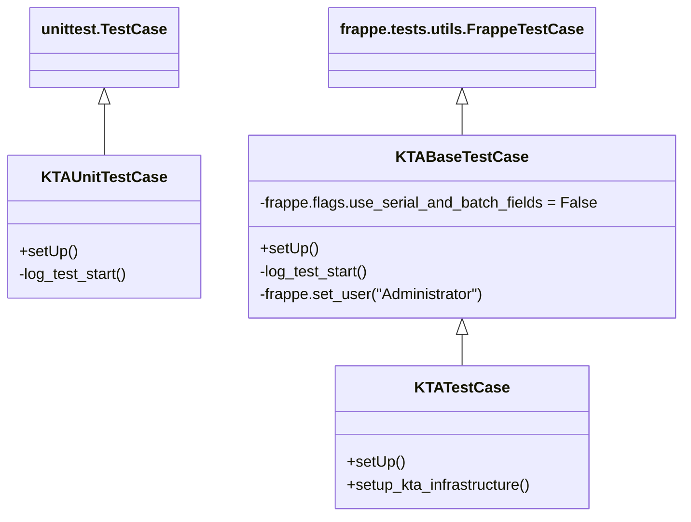

# Test Altyapısının Modülerleştirilmesi, Dizin Yapılanması ve Log Standardizasyonu — Tasarım

- **Durum:** Onaya Hazır
- **Tarih:** 2026-11-15
- **Modüller:** `erpnextkta/tests`, `kta_calisma_karti`, `kta_stock`, `kta_mrp`, `kta_quality`, `overrides`

---

## 1. Amaç ve Neden

1. **Eksiksiz Test Görünürlüğü (159/159):** Repodaki 159 test çalıştırıldığında şu an sadece `KTATestCase` ve `KTAUnitTestCase` miras alan sınıflar konsola `🔍 [TEST]` logu basmakta, kalan testler ise `stderr` buffer'ı üzerinden en sonda `...................................................` şeklinde yığılmaktadır. Tüm testlerin modül ve metot bazında izlenebilir hale getirilmesi hedeflenmektedir.
2. **Modüler Dizin Yapısı (Seçenek A):** `erpnextkta/tests/` kök dizininde yığılmış olan ve aslında `kta_stock`, `kta_mrp` veya `kta_calisma_karti` modüllerine ait olan test dosyalarının kendi modül dizinlerine (`<module>/tests/`) taşınması.
3. **Kopya Fixture Kodlarının Temizlenmesi:** Kalıp, tolerans, alt operasyon, şirket ve depo kurma gibi farklı test dosyalarında kopyalanarak yazılmış ~150-200 satırlık boilerplate kodların `test_utils.py` içinde ortak yardımcı metotlara toplanması.
4. **Test Discovery Kirliliğinin Önlenmesi:** `kta_calisma_karti/scripts/` altında bulunan ve aslında manuel bir kontrol scripti olan `test_qc_integration.py` dosyasının `verify_qc_integration.py` olarak yeniden adlandırılarak otomatik test çalıştırıcısını (test runner) yanıltmasının engellenmesi.

---

## 2. Mimari ve Tasarım

### 2.1 Üç Kademeli Test Taban Sınıfı Mimarisi (`test_utils.py`)

1. **`KTAUnitTestCase(unittest.TestCase)`:**
   - **Kullanım:** Veritabanı gerektirmeyen veya tüm bağımlılıkları `unittest.mock` ile mock'lanan saf birim testler.
   - **Örnekler:** `test_calisma_karti_unit.py`, `test_label_manager.py`.
   - **Özellik:** Sıfır DB maliyeti, milisaniyeler içinde çalışır, `log_test_start(self)` devrededir.

2. **`KTABaseTestCase(FrappeTestCase)`:**
   - **Kullanım:** Veritabanına bağlanan, belge oluşturan/sorgulayan ancak Çalışma Kartı'nın ağır İş Emri + Job Card altyapısına ihtiyaç duymayan entegrasyon testleri.
   - **Örnekler:** `test_iade_edilebilir_ambalaj_fisi.py`, `test_mrp_analysis.py`, `test_enjeksiyon_kalip_api.py`.
   - **Özellik:** `frappe.set_user("Administrator")` otomatik ayarlanır, Frappe test transaction rollback'i aktiftir, `log_test_start(self)` devrededir, her test için gereksiz yere Job Card oluşturup silmez.

3. **`KTATestCase(KTABaseTestCase)`:**
   - **Kullanım:** Çalışma Kartı, Job Card, süre hesaplama ve üretim senkronizasyonunu uçtan uca test eden sınıflar.
   - **Örnekler:** `test_calisma_karti.py`, `test_api.py`, `test_job_card_sync.py`, `test_enjeksiyon_kalip_full.py`, `test_qi_validation.py`.
   - **Özellik:** `setup_kta_infrastructure()` ile İş İstasyonu, Operasyon, İş Emri, Job Card ve KTA Ayarlarını izole ve hazır olarak sunar.

---

### 2.2 Dizin Yeniden Yapılandırması (Dosya Taşımaları)

Test dosyaları ait oldukları iş alanına göre organize edilecektir (`git mv`):

| Kaynak Dosya | Hedef Dosya | Ait Olduğu Kapsam | Yeni Taban Sınıfı |
|---|---|---|---|
| `erpnextkta/tests/test_label_manager.py` | `erpnextkta/kta_stock/tests/test_label_manager.py` | `kta_stock` | `KTAUnitTestCase` |
| `erpnextkta/tests/test_mrp_analysis.py` | `erpnextkta/kta_mrp/tests/test_mrp_analysis.py` | `kta_mrp` | `KTABaseTestCase` |
| `erpnextkta/tests/test_api.py` | `erpnextkta/kta_calisma_karti/tests/test_api.py` | `kta_calisma_karti` | `KTATestCase` |
| `erpnextkta/tests/test_qi_validation.py` | `erpnextkta/kta_calisma_karti/tests/test_qi_validation.py` | `kta_calisma_karti` | `KTATestCase` |
| `erpnextkta/tests/test_enjeksiyon_kalip_api.py` | `erpnextkta/kta_calisma_karti/tests/test_enjeksiyon_kalip_api.py` | `kta_calisma_karti` | `KTABaseTestCase` |
| `erpnextkta/tests/test_enjeksiyon_kalip_full.py` | `erpnextkta/kta_calisma_karti/tests/test_enjeksiyon_kalip_full.py` | `kta_calisma_karti` | `KTATestCase` |
| `erpnextkta/tests/test_mold_patch.py` | `erpnextkta/kta_calisma_karti/tests/test_mold_patch.py` | `kta_calisma_karti` | `KTABaseTestCase` |
| `erpnextkta/kta_calisma_karti/scripts/test_qc_integration.py` | `erpnextkta/kta_calisma_karti/scripts/verify_qc_integration.py` | Manuel Script | *(TestCase değil)* |

**`erpnextkta/tests/` Kök Klasöründe Kalanlar:**
- `test_utils.py` (Paylaşılan altyapı)
- `test_job_card_sync.py` (ERPNext core Job Card override entegrasyonu)
- `test_purchase_receipt.py` (ERPNext core Purchase Receipt override entegrasyonu)

---

### 2.3 Doctype İçi Testlerin Taban Sınıflara Bağlanması

Kendi doctype klasörlerinde bulunan test sınıfları da ilgili taban sınıfa geçirilecektir:
- `kta_stock/doctype/iade_edilebilir_ambalaj_fisi/test_iade_edilebilir_ambalaj_fisi.py` ➡️ `KTABaseTestCase`
- `kta_calisma_karti/doctype/calisma_karti_enjeksiyon_olcumleri/test_calisma_karti_enjeksiyon_olcumleri.py` ➡️ `KTATestCase`
- `kta_calisma_karti/doctype/calisma_karti_idc_olcumleri/test_calisma_karti_idc_olcumleri.py` ➡️ `KTATestCase`
- `kta_calisma_karti/doctype/calisma_karti_hurda/test_calisma_karti_hurda.py` ➡️ `KTATestCase` (Zaten öyleydi)
- `kta_calisma_karti/doctype/kta_enjeksiyon_kalibi/test_kta_enjeksiyon_kalibi.py` ➡️ `KTABaseTestCase`
- `kta_calisma_karti/doctype/kta_calisma_karti_operasyonlari/test_kta_calisma_karti_operasyonlari.py` ➡️ `KTATestCase` (Zaten öyleydi)
- `kta_calisma_karti/doctype/kta_durus_sebebi/test_kta_durus_sebebi.py` ➡️ `KTATestCase` (Zaten öyleydi)

---

### 2.4 Ortak Fixture'lar (`test_utils.py`)

Birden fazla test dosyasında kopyalanan kalıp ve operasyon hazırlıkları `test_utils.py` içine taşınacaktır:
- `ensure_test_injection_fixtures()`: `OP40` operasyonu, `OP40-0001`/`OP40-E2E` alt operasyonları ve test kalıplarını (`KLP-*`) garanti altına alır.
- `ensure_test_idc_fixtures()`: IDC test malzeme grupları ve ara malzeme gruplarını garanti altına alır.

---

## 3. Doğrulama ve Kabul Kriterleri

1. **Sıfır Regresyon:** `bench run-tests --app erpnextkta` çalıştırıldığında toplam testlerin tamamı başarıyla (`OK`) geçmelidir.
2. **100% Zengin Log:** Konsol çıktısında hiçbir `.....................` nokta yığını kalmamalı; her test `🔍 [TEST] [<modül>] [<metot>]: <açıklama>` şeklinde konsola akmalıdır.
3. **Temiz Dizin Yapısı:** Test dosyaları ait oldukları modül klasörlerinde (`kta_stock/tests`, `kta_mrp/tests`, `kta_calisma_karti/tests`) bulunmalıdır.
