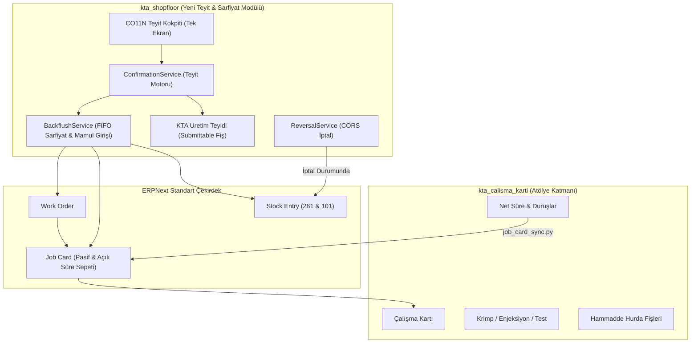

# Tasarım Dokümanı: SAP CO01 / CO11N Modelinde Modüler Üretim Teyit Motoru

**Tarih:** 2026-11-17  
**Durum:** Onaylandı  
**Kapsam:** `erpnextkta` -> Yeni Modül: **`kta_shopfloor`**  

---

## 1. Amaç ve Gerekçe (Intent & Why)

### 1.1 Mevcut Durum ve Sorun
Kablo tesisatı, krimp ve montaj süreçlerinde üretim yapan işletmemizde ERPNext standart üretim ve teyit mantığı ciddi darboğazlara yol açmaktadır:
1. **İş Emri & Job Card Kısmi Üretim Tıkanıklığı:** ERPNext'te Job Card toplam iş emri miktarı için açılır ve kısmi submit (`docstatus=1`) desteklemez.
2. **Peel-Off (Bölme/Koparma) İşkencesi:** Önceki geliştirmede (`feat-partial-job-card-submit`), kısmi üretim ve malzeme tüketimi yapabilmek için mevcut Job Card'dan adet koparıp yeni bir Job Card oluşturan ("peel-off") karmaşık bir mekanizma denenmiştir. Bu durum; sahte `"Material Transferred"` statülerine, `Calisma Karti` referans kaymalarına, `kta_sync_mode` bayraklarına ve takip edilemez bir Job Card çöplüğüne yol açmıştır.
3. **Atölye Veri Güvenilirliği:** Atölye operatörlerinden gelen ham adet ve barkod verileri doğrudan stok tüketimine bağlanamaz; stok sarfiyatı (261 Backflush) ve mamul girişi (101 GR) ancak yetkili ekip arkadaşlarının fiziki sayımı ve onayıyla yapılabilir.
4. **Modüler İzolasyon İhtiyacı (`kta_shopfloor`):** Mevcut `kta_calisma_karti` modülü atölye sürelerini, duruşları ve krimp kalite ölçümlerini tutmaktadır. Yeni CO11N teyit motorunun bu yapıya yük bindirmeden, tamamen bağımsız ve temiz bir modül olan **`kta_shopfloor`** altında toplanması kararlaştırılmıştır.

### 1.2 Hedef Çözüm
Yeni **`kta_shopfloor`** modülü altında:
- **`Job Card` = Pasif ve Açık Veri Konteyneri:** Job Card'lar standart açılır. Operatörler barkodunu okutur, `Calisma Karti` net süreleri `Job Card Time Log` tablosuna aktarır, kalite kontrolleri Job Card'a bağlanır. Job Card **asla bölünmez ve kısmi tüketim için submit edilmeye zorlanmaz**.
- **`kta_shopfloor / CO11N Teyit Kokpiti`:** Yetkili ekip arkadaşları fiziki sayımı yapıp bu ekrandan sağlam miktarı (Yield Qty) girer.
  - Ara operasyonda: O operasyona ait hammaddeleri ERPNext'in yerel FIFO'su ile anında sarf eder (261 Backflush - `Material Consumption`).
  - Son operasyonda: Kalan genel sarfları düşüp mamul ambarına girişi yapar (101 GR - `Manufacture`).
  - Eksik üretim durumlarında ekrandaki "Son Teyit (Kalanı Kapat)" seçeneğiyle iş emri ve Job Card tamamlandı statüsüne alınır.

---

## 2. Hedefler, Kapsam Dışı Konular ve Anti-Hedefler

### 2.1 Hedefler (Goals)
* Yeni `kta_shopfloor` modülünün (`modules.txt`, Frappe `Module Def` JSON ve `.agents/subagents/kta-shopfloor.md`) oluşturulması.
* `peel_off_partial_production` ve Job Card klonlama kodlarının `job_card.py` üzerinden tamamen temizlenmesi.
* Yetkili ekip arkadaşlarının kullanımı için hızlı, barkod destekli bir **CO11N Üretim Teyit Ekranı (SPA & Desk)** sunmak.
* Her teyit işleminin bağımsız, değiştirilemez ve denetlenebilir bir **`KTA Uretim Teyidi` (Submittable DocType)** olarak `kta_shopfloor` altında kaydedilmesi.
* Ara operasyonlarda operasyona ait hammaddelerin anlık `Material Consumption for Manufacture` ile stoktan düşülmesi (261 Backflush).
* ERPNext'in `Auto Create Serial and Batch Bundle for Outward = 1` özelliğini kullanarak hammadde lotlarının otomatik FIFO ile tüketilmesini sağlamak.
* Son operasyonda otomatik `Manufacture` stok fişi ile mamulün `fg_warehouse` ambarına alınması (101 GR) ve iş emrinin tamamlanması.
* CO11N ekranında **"Son Teyit (Kalanı Kapat)"** bayrağı ile hedef adede tam ulaşılamasa bile (örn: hurda nedeniyle 100 yerine 96 sağlam) iş emri ve operasyonların kapatılabilmesi.
* Operasyonlar arası sıralı kilitleme olmadan **tamamen bağımsız teyit girilebilmesi** (istasyonlar birbirini beklemez).
* Hatalı teyitlerde **SAP CORS** mantığıyla yetkili iptali ve ilişkili stok fişlerinin otomatik ters kaydını (`cancel`) gerçekleştirmek.
* `kta_calisma_karti` ve `job_card_sync.py` süre/kalite akışının kesintisiz ve bozulmadan devam etmesi.

### 2.2 Kapsam Dışı (Non-Goals)
* Operatörlerin girdiği `Calisma Karti`'nın doğrudan otomatik stok tüketimi tetiklemesi (operatör ham verisi stoka bağlanmayacaktır).
* CO11N ekranında yetkili arkadaşlara fire/hurda girişi yaptırmak (hammadde hurdaları operatörler tarafından mevcut `Calisma Karti Hurda` üzerinden girilmeye devam edecektir).
* Job Card dokümanını sistemden silmek (Job Card açık bir süre ve kalite taşıyıcısı olarak yaşayacaktır).

### 2.3 Anti-Hedefler (Neler Kesinlikle Yapılmayacak?)
* **Job Card Bölme / Klonlama:** Asla Job Card A'dan adet koparıp Job Card B oluşturulmayacak.
* **Kısmi Tüketim İçin Job Card Submit Zorlaması:** Job Card ara tüketimler için submit edilmeyecek; stok hareketi doğrudan `kta_shopfloor` servisleri tarafından yönetilecek.

---

## 3. Mimari Yapı ve Modül Ayrımı

---

## 4. Detaylı Sistem Tasarımı ve İş Akışı

### 4.1 Teyit İşlem Döngüsü ve Hammadde Hesaplama Mantığı

#### 4.1.1 Hammadde Sarfiyatı Hesaplama Formülü
$$\text{Tüketilecek Miktar} = \left( \frac{\text{Teyit Edilen Sağlam Miktar}}{\text{İş Emri Toplam Hedef Miktarı}} \right) \times \text{BOM Toplam İhtiyaç Miktarı}$$

* **Ara Operasyonlar:** Yalnızca o operasyon satırına (`d.operation == current_operation`) atanmış hammaddeler oranlanarak sarf edilir.
* **Operasyonsuz BOM Kalemleri (Bant, Etiket, Kelepçe vb.):** Ara operasyonlarda sarf edilmez; yalnızca son operasyon teyit edildiğinde oranlanarak sarf edilir.
* **Son Teyit / Bakiye Kapatma:** "Son Teyit (Kalanı Kapat)" işaretlendiğinde kalan sarfiyat küsürat yuvarlamalarına takılmadan doğrudan bakiye farkından kapatılır:
  $$\text{Son Teyit Sarfiyatı} = \text{Toplam Reçete Miktarı} - \text{Önceki Teyitlerde Tüketilmiş Miktar}$$

#### 4.1.2 Atomik İşlem Adımları
1. **Giriş:** Yetkili ekip arkadaşı CO11N ekranına girer:
   * İş Emri No (veya Job Card barkodu) okutur/seçer.
   * Operasyonu seçer (Örn: 0010 Kesim).
   * Fiziki sayılan **Sağlam Miktar (Yield Qty)** girer.
   * Gerekirse **"Son Teyit (Kalanı Kapat)"** seçeneğini işaretler.
   * "Teyit Et" butonuna basar.
2. **Kayıt ve Stok Hareketi:**
   * **`KTA Uretim Teyidi`** dokümanı `kta_shopfloor` altında oluşturulur ve submit edilir (`docstatus=1`).
   * **Ara Operasyon:**
     * Work Order `required_items` içinden bu operasyona atanmış hammaddeler tespit edilir.
     * Operasyonda hammadde varsa orantısal miktar hesaplanır ve `Stock Entry (Material Consumption for Manufacture)` oluşturulur. Sistem `auto_create_serial_and_batch_bundle_for_outward=1` ile FIFO partilerini otomatik atar ve fişi submit eder.
   * **Son Operasyon (Milestone):**
     * Kalan genel sarflar düşülür.
     * Ara operasyonlardaki birikmiş hammadde maliyetleri mamule orantısal yansıtılır (WIP Rollup).
     * `Stock Entry (Manufacture)` fişi ile mamul `fg_warehouse` ambarına alınır ve Work Order `produced_qty` artırılır.
   * **İlerleme ve Kapanış Güncellemesi:**
     * İlgili operasyonun ve Job Card'ın `total_completed_qty` alanı artırılır.
     * Hedef miktar tamamlandığında veya "Son Teyit" işaretlendiğinde Job Card durumu `"Completed"` yapılır ve Work Order kapatılır. (Job Card `docstatus=0` kalır; Frappe kilitlenmeleri önlenir).

### 4.2 İptal ve Ters Kayıt (SAP CORS)
* Yetkili ekip arkadaşı hatalı girilen bir `KTA Uretim Teyidi` dokümanını iptal ettiğinde (`docstatus=2`):
  * `ReversalService` ilgili teyide bağlı `Stock Entry` fişini bulur ve `cancel` eder.
  * Work Order ve Job Card üzerindeki tamamlanan miktarı geri çeker.

### 4.3 Temizlenecek ve Düzeltilecek Kodlar (`feat-partial-job-card-submit`)
* `erpnextkta/overrides/job_card.py`:
  * `peel_off_partial_production` metodu tamamen silinecek.
  * `_create_consumption_entry_if_needed` ve `_cancel_consumption_entries` metotları Job Card üzerinden kaldırılıp `kta_shopfloor/services/backflush_service.py` içine taşınacak.
  * `public/js/job_card.js` içindeki "Kısmi Üretim Bildir" butonu kaldırılacak.
* `erpnextkta/overrides/KTAStockEntry.py`:
  * `check_if_operations_completed` metodu; Job Card aramak yerine Work Order operasyon satırındaki `completed_qty` değerini doğrulamaya devam edecek (mamul girişi engellenmeyecek).

---

## 5. Kullanıcı Deneyimi (UI/UX)
* **CO11N Tek Ekran Arayüzü:**
  * Barkod okuyucu uyumlu sade giriş (İş Emri / Job Card okutulunca operasyon detayları otomatik yüklenir).
  * Hedef miktar, şu ana kadar teyit edilmiş sağlam miktar ve açık miktar göstergeleri.
  * "Sağlam Miktar" girişi, "Son Teyit (Kalanı Kapat)" onay kutusu ve büyük dokunmatik "Teyit Et" butonu.
  * İşlem sonucu oluşan Stock Entry linki ve başarı bildirimi.
* **Frappe Desk Formu:**
  * Yöneticiler için geçmiş teyitlerin listelendiği, filtrelendiği ve CORS iptalinin yapılabildiği standart Frappe Liste ve Form görünümü.
