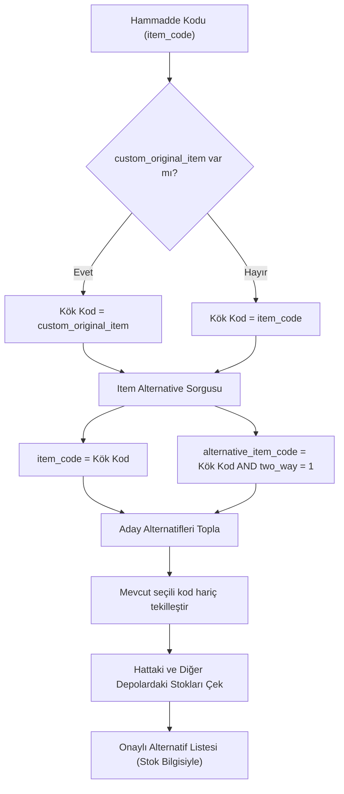
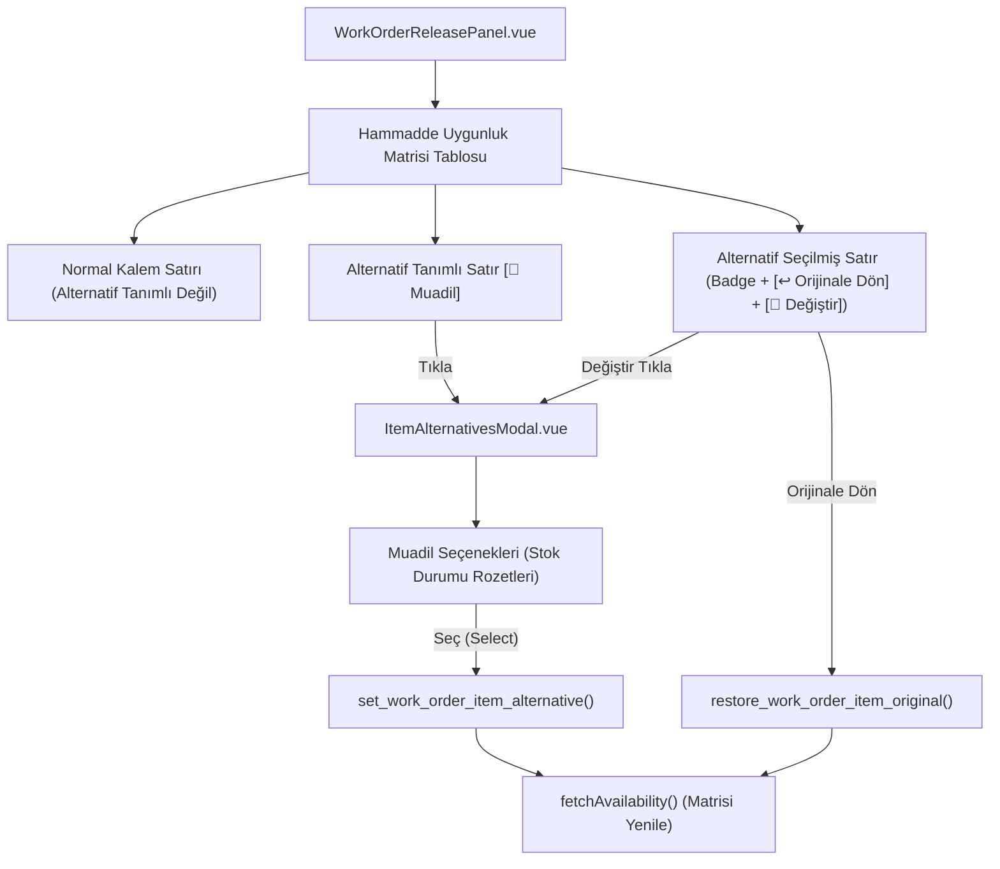

# Tasarım Dokümanı: İş Emri Alternatif Hammadde Yönetimi ve Tüketim Motoru

**Tarih:** 2026-11-18  
**Durum:** Nihai Tasarım (Tüm Kararlar Çözüldü & Onaylandı)  
**Yazar:** Tech Lead / Coordinator & docs-i18n  
**Hedef Kapsam:** `erpnextkta/kta_shopfloor/**`, `erpnextkta/public/shopfloor-hub/**`, `erpnextkta/erpnextkta/custom/**`, `erpnextkta/overrides/**`, `erpnextkta/translations/**`, `erpnextkta/www/docs/**`, `docs/**`

---

## 1. Amaç ve Arka Plan (Intent & Why)

Üretim sahasında (kablo montaj, konnektör, terminal, enjeksiyon vb.) hammadde tedarik dalgalanmaları, minimum sipariş miktarları veya eski stokların eritilmesi (FIFO/parti önceliği) gibi nedenlerle reçetede (BOM) belirtilen orijinal hammadde yerine onaylı bir muadilinin (alternatifinin) kullanılması zorunlu hale gelebilmektedir.

Mevcut durumda:
1. Reçetedeki orijinal hammadde depoda tükendiğinde veya parti eritme amacıyla muadil hammadde kullanılmak istendiğinde, kullanıcıların standart ERPNext üzerinden karmaşık iş emri satır düzenlemeleri yapması gerekmekte veya hatalı stok kayıtları oluşmaktadır.
2. Atölye zeminindeki Shopfloor Hub Serbest Bırakma Panelinde (`WorkOrderReleasePanel.vue`), operatör veya hat lideri eksik hammaddeyi görebilmekte ancak tanımlı onaylı alternatifleri doğrudan ekrandan seçip iş emrine atayamamaktadır.
3. Operasyon teyitlerinde (SAP CO11N benzeri backflush tüketim mekanizması), standart ERPNext kontrol mekanizması (`validate_components_quantities_per_bom`), reçetede yer almayan bir bileşenin tüketim fişinde bulunması durumunda `Incorrect Component Quantity` veya `Missing Item` hatası fırlatarak üretim teyidini kilitlemektedir.

Bu tasarım dokümanı; Shopfloor Hub üzerinden hatasız (Poke-Yoke), izlenebilir (orijinal kod hafızası ve tek tıkla geri alma), çok yönlü onaylı muadilleri destekleyen ve arka planda CO11N operasyon teyidi tüketim motoru ile tam entegre çalışan uçtan uca alternatif hammadde yönetim mimarisini tanımlar.

---

## 2. Hedefler, Kapsam Dışı ve Anti-Hedefler

### 2.1 Hedefler (Goals)

1. **Shopfloor Hub Üzerinden Alternatif Seçimi:**
   - İş Emri Serbest Bırakma ve Malzeme Hazırlık Panelinde (`WorkOrderReleasePanel.vue`), bileşen matrisi satırlarında tanımlı alternatifi bulunan malzemeler için sezgisel bir `[ 🔄 Muadil / Alternatif ]` butonu sunulması.
2. **Katı Poke-Yoke (Hatasızlaştırma):**
   - Kullanıcıların iş emrine serbest metinle veya reçete onayı bulunmayan rastgele bir kalem eklemesi kesin olarak engellenir.
   - Yalnızca ERPNext'in `Item Alternative` dokümanında o hammadde için tanımlanmış ve onaylanmış muadiller (çift yönlü `two_way=1` kayıtları dahil) seçilebilir.
3. **Stok Eritme ve Proaktif Alternatif Kullanımı:**
   - Alternatif seçimi yalnızca stoğu kritik/eksik olan kalemlerle sınırlı değildir. Stoğu depoda tam olan satırlarda da tanımlı alternatif varsa (eski lotu eritme, müşteri onaylı alternatif parti kullanımı vb.), kullanıcı dilediğinde alternatifi tercih edebilir.
4. **Orijinal Reçete İzi ve Tek Tıkla Geri Alma (Restore):**
   - Alternatif seçildiğinde, `Work Order Item` üzerinde `custom_original_item` alanı doldurularak orijinal reçete kodu korunur.
   - Kullanıcı dilediğinde tek bir tıkla `[ ↩️ Orijinale Dön ]` aksiyonunu çalıştırarak satırı orijinal reçete bileşenine ve açıklamalarına geri döndürebilir.
5. **Backflush Tüketim & KTAStockEntry Uyumluluğu:**
   - Operasyon teyitlerinde `BackflushService` doğrudan `wo.required_items` üzerinde yer alan güncel alternatifi tüketir.
   - `KTAStockEntry` sınıfı, ERPNext standart `validate_components_quantities_per_bom` doğrulamasını onaylı alternatifler için güvenli şekilde esnetir; yanlış hata fırlatılmasını önler ve gerçek alternatif malzeme maliyetinin stok muhasebesine doğru yansımasını sağlar.
6. **İş Emri Denetim İzi (Audit Trail):**
   - Alternatif seçildiğinde ve orijinal koda geri dönüldüğünde Work Order aktivite geçmişine (Comment) otomatik denetim kaydı eklenir.

### 2.2 Kapsam Dışı (Non-Goals)

- Standart ERPNext Reçete (BOM) üzerinde kalıcı değişiklik yapmak (alternatif seçimi sadece ilgili İş Emri için geçerlidir; ana reçeteyi değiştirmez).
- `Item Alternative` dokümanlarının Shopfloor Hub içinden oluşturulması veya onaylanması (muadil tanımları ERPNext ana menüsünden Yetkili Kalite/Mühendislik rolleri tarafından tanımlanır).
- Müşteriye özel dinamik fiyat farkı veya alternatif malzeme ek fiyat faturalandırması.

### 2.3 Anti-Hedefler (Anti-Goals)

- **Serbest Malzeme Girişi:** Operatörün arama kutusuna serbest kod yazarak sistemde muadil tanımlı olmayan bir hammaddeyi seçebilmesine izin verilmesi.
- **Kısmi Tüketimden Sonra Alternatif Değişimi:** Satırda `consumed_qty > 0` veya `transferred_qty > 0` iken alternatif değiştirilmesine izin verilemez (veri tutarsızlığı ve negatif stok riskini önlemek için Poke-Yoke blokajı).

---

## 3. Kısıtlamalar (Constraints)

1. **Mimari & Kod Kuralları:**
   - `.agents/AGENTS.md` gereğince hiçbir DocType veya alan Türkçe isimle oluşturulamaz (`custom_original_item` kullanılacaktır).
   - Tüm arayüz metinleri TR, EN ve DE dillerine uygun `__('Text')` translation wrapper'ları ile sarılacak ve CSV sözlüklerine Title Case formatında eklenecektir.
   - Frontend derlemesi istisnasız `bench build --app erpnextkta --production` komutuyla doğrulanmalıdır.
   - Python kodları `/home/frappe/frappe-bench/env/bin/ruff check` ve `format` kurallarına uymalıdır.
2. **Ticari Gizlilik:**
   - Dokümantasyon ve test verilerinde hiçbir spesifik tedarikçi/müşteri unvanı veya gerçek ticari birim fiyat yer alamaz.

---

## 4. Değerlendirilen Yaklaşımlar (Approaches)

### Yaklaşım 1: Panel İçi Modüler Alternatif Modali & Doğrudan WO Item Güncellemesi (SEÇİLEN)
- **Açıklama:** `WorkOrderReleasePanel.vue` bileşeninde malzeme matrisine alternatif durumu ve butonu eklenir. Tıklandığında açılan `ItemAlternativesModal.vue`, ilgili hammadde için onaylı alternatifleri ve bu alternatiflerin hattaki / diğer depolardaki güncel stok seviyelerini listeler. Seçim yapıldığında backend `set_work_order_item_alternative` servisi çağrılarak `Work Order Item` güncellenir.
- **Avantajları:** Ergonomik, operatör için son derece hızlı; stok durumunu görerek en uygun alternatifi seçme imkanı sunar; `custom_original_item` ile tam izlenebilirlik sağlar.
- **Karar:** Oy birliğiyle seçildi.

### Yaklaşım 2: Alternatifleri Teyit Sırasında Seçtiren Dinamik Backflush Modali (ELENDİ)
- **Açıklama:** İş Emri serbest bırakılırken orijinal haliyle bırakılır; her operasyon teyidi (CO11N) sırasında operatöre açılan bir popup ile "Alternatif tüketecek misiniz?" diye sorulur.
- **Elenme Sebebi:** Atölye zemininde her teyitte gereksiz diyalog kalabalığı yaratır, teyit süresini uzatır, hat liderinin önceden malzeme hazırlığı yapmasını zorlaştırır.

---

## 5. Detaylı Mimari ve Teknik Tasarım

### 5.1 Veri Modeli ve Şema Tasarımı

#### A. `Work Order Item` DocType (`erpnextkta/erpnextkta/custom/work_order_item.json`)
Mevcut `Work Order Item` alt tablosuna aşağıdaki özel alan eklenir:
- **`custom_original_item`**:
  - `fieldtype`: `Link`
  - `options`: `Item`
  - `label`: `Original Item`
  - `read_only`: `1`
  - `no_copy`: `1`
  - `description`: "Reçetedeki asıl bileşen kodu (alternatif seçildiğinde saklanır)."

#### B. `Stock Entry Detail` DocType (`erpnextkta/erpnextkta/custom/stock_entry_detail.json`)
ERPNext `Stock Entry Detail` tablosunda standart `original_item` alanı mevcuttur. KTA denetim izi ve raporlama tutarlılığı için:
- **`custom_original_item`**:
  - `fieldtype`: `Link`
  - `options`: `Item`
  - `label`: `Original Item`
  - `read_only`: `1`
  - `no_copy`: `1`
- `BackflushService` hem standart `original_item` hem de `custom_original_item` alanlarını doldurarak geriye dönük tam uyumluluk sağlar.

---

### 5.2 Alternatif Çözümleme ve Poke-Yoke Mantığı

Bir hammadde (`item_code`) için geçerli alternatifler sorgulanırken şu kurallar işletilir:



1. **Kök Kod Tespiti:** Satırda zaten bir muadil seçilmişse (`custom_original_item` doluysa), alternatif sorgusu her zaman kök orijinal kod üzerinden yapılır; böylece alternatiften alternatife geçişlerde reçete bağı kopmaz.
2. **Çift Yönlü Muadil Desteği (`two_way=1`):** `Item Alternative` tablosunda hem doğrudan tanımlar (`item_code = base`) hem de ters yönlü izin verilenler (`alternative_item_code = base AND two_way = 1`) listeye dahil edilir.
3. **Onaysız Kalem Engelleme:** Kullanıcı yalnızca bu sorgudan dönen listedeki bir kalemi seçebilir. Backend'de API seviyesinde doğrulama yapılarak listede olmayan bir kalem gönderilirse `frappe.ValidationError` fırlatılır.

---

### 5.3 Backend Servis Mimarisi (`erpnextkta/kta_shopfloor/services/work_order_service.py`)

Aşağıdaki fonksiyonlar `work_order_service.py` içerisine eklenecektir:

#### 1. `get_item_alternatives(item_code: str, company: str | None = None, warehouse: str | None = None) -> list[dict]`
- Belirtilen malzeme için `Item Alternative` tablosunu tarar.
- Her muadil için:
  - `alternative_item_code`, `item_name`, `description`, `stock_uom`
  - `line_available_qty`: Belirtilen hatta/depodaki net kullanılabilir stok (`actual_qty - reserved_qty`).
  - `other_warehouses_qty`: Şirketin diğer aktif depolarındaki kullanılabilir stok toplamı.
  - `total_available_qty`: Toplam serbest stok.
  - `two_way`: Çift yönlü onay durumu.
- Sonuç listesini toplam stok miktarına göre azalan sırada döner.

#### 2. `get_work_order_item_alternatives(work_order: str, row_name: str) -> dict`
- İlgili `Work Order Item` satırını bulur.
- Orijinal kodu (`custom_original_item` veya mevcut `item_code`) belirler.
- Depo ve şirket parametreleriyle `get_item_alternatives` fonksiyonunu çağırır.
- Satırın mevcut durumu (`item_code`, `custom_original_item`, `consumed_qty`, `is_alternative`) ile muadil seçeneklerini paketleyip döner.

#### 3. `set_work_order_item_alternative(work_order: str, row_name: str, alternative_item_code: str) -> dict`
- **Poke-Yoke Doğrulamaları:**
  - İş Emri durumu kontrol edilir (İptal edilmiş veya Kapatılmış olamaz).
  - Satırda tüketim kontrolü: `flt(row.consumed_qty) > 0` veya `flt(row.transferred_qty) > 0` ise işlem engellenir:
    `_("Kısmi tüketim veya transfer yapılmış hammadde için alternatif seçilemez.")`
  - Muadil onay kontrolü: `alternative_item_code`, kök kod için tanımlı resmi alternatifler arasında bulunmalıdır.
- **Güncelleme İşlemi:**
  - Satırın `custom_original_item` alanı boşsa, mevcut `item_code` buraya yazılır.
  - Satırın `item_code` alanı `alternative_item_code` olarak değiştirilir.
  - `item_name`, `description`, `stock_uom` alanları yeni malzemeye göre güncellenir.
  - Satır kaydedilir (`row.db_update()` veya Work Order `save(ignore_permissions=True)`).
- **Denetim İzi & Malzeme Kontrolü:**
  - Work Order aktivite geçmişine yorum eklenir:
    `_("Hammadde alternatifi seçildi: {0} yerine {1}").format(orig_item, alternative_item_code)`
  - `check_work_order_material_availability(work_order)` tekrar çalıştırılır ve güncel uygunluk özeti dönülür.

#### 4. `restore_work_order_item_original(work_order: str, row_name: str) -> dict`
- **Doğrulamalar:**
  - Satırda `custom_original_item` dolu olmalıdır.
  - `flt(row.consumed_qty) > 0` ise işlem engellenir.
- **Geri Alma İşlemi:**
  - Orijinal kod geri yüklenir: `item_code = custom_original_item`.
  - `custom_original_item = None` yapılır.
  - `item_name`, `description`, `stock_uom` orijinal kaleme göre yeniden çekilip güncellenir.
  - Aktivite yorumu eklenir:
    `_("Hammadde orijinal reçete koduna geri döndürüldü: {0}").format(orig_item)`
  - Güncel malzeme uygunluk durumu hesaplanıp dönülür.

---

### 5.4 Backend API Kontratı (`erpnextkta/kta_shopfloor/api.py`)

Aşağıdaki beyaz listeli (whitelisted) API uçları tanımlanacaktır:

1. **`get_work_order_item_alternatives(work_order: str, row_name: str) -> dict`**
   - Parametreler: `work_order` (str), `row_name` (str)
   - Dönüş:
     ```json
     {
       "work_order": "MFG-WO-2026-00042",
       "row_name": "48a9b2c1",
       "current_item_code": "ALT-KABLO-075-KRM",
       "original_item_code": "KABLO-075-KRM",
       "is_swapped": true,
       "consumed_qty": 0.0,
       "can_swap": true,
       "alternatives": [
         {
           "item_code": "ALT-KABLO-075-KRM",
           "item_name": "Alternatif 0.75 Kırmızı Kablo",
           "line_available_qty": 1250.0,
           "other_warehouses_qty": 5000.0,
           "total_available_qty": 6250.0,
           "stock_uom": "Metre"
         }
       ]
     }
     ```

2. **`set_work_order_item_alternative(work_order: str, row_name: str, alternative_item_code: str) -> dict`**
   - Parametreler: `work_order` (str), `row_name` (str), `alternative_item_code` (str)
   - Yetki: Work Order `write` izni.

3. **`restore_work_order_item_original(work_order: str, row_name: str) -> dict`**
   - Parametreler: `work_order` (str), `row_name` (str)
   - Yetki: Work Order `write` izni.

---

### 5.5 CO11N Backflush Tüketim Motoru & KTAStockEntry Entegrasyonu

#### A. `BackflushService` (`erpnextkta/kta_shopfloor/services/backflush_service.py`)
- `calculate_operation_raw_materials` fonksiyonu `wo.get("required_items")` üzerinde dolaşırken:
  - Tüketilecek hammadde kodu doğrudan `d.get("item_code")` (yani seçilen alternatif) olur.
  - Satır verisine `"original_item": d.get("custom_original_item")` alanı eklenir.
- `create_consumption_entry` fonksiyonu `Stock Entry` kalemini oluştururken:
  - `se.append("items", { "item_code": rm["item_code"], "original_item": rm.get("original_item"), "custom_original_item": rm.get("original_item"), ... })`
  - Bu sayede stoktan düşülen malzeme **fiilen tüketilen alternatif malzeme** olur ve alternatifin kendi hareketli ağırlıklı maliyeti (valuation rate) finansal kayıtlara işlenir.

#### B. `KTAStockEntry` Sınıfı (`erpnextkta/overrides/KTAStockEntry.py`)
- Standart ERPNext `validate_components_quantities_per_bom()` fonksiyonu:
  - Reçete (BOM) satırlarını inceler; eğer BOM'daki `item_code` stok fişinde doğrudan birebir bulunmazsa hata verir.
- **KTA Override Çözümü:**
  - `validate_components_quantities_per_bom` override edilir:
    Stok fişindeki kalemler taranırken, eğer bir kalem BOM'da doğrudan yoksa ancak:
    1. Kalemin `original_item` veya `custom_original_item` alanı BOM'daki ilgili bileşeni işaret ediyorsa, VEYA
    2. Kalem, BOM'daki bileşen için geçerli bir `Item Alternative` (tek veya çift yönlü) olarak tanımlıysa,
  - Sistem bu kalemi BOM'daki orijinal bileşenle eşleştirir, miktar toleransını doğrular ve reçete uyuşmazlığı hatası vermeksizin işlemi onaylar.

---

### 5.6 Frontend Bileşen Mimarisi (`shopfloor-hub`)



#### A. `ItemAlternativesModal.vue` (`erpnextkta/public/shopfloor-hub/components/ItemAlternativesModal.vue`)
- **Başlık & Özet:** Seçili bileşen kodu, adı ve varsa orijinal reçete kodu.
- **Muadil Listesi Tablosu:**
  - Sütunlar: Muadil Kodu, Muadil Adı, Hatta Stok, Diğer Depolarda Stok, Toplam Kullanılabilir Stok, İşlem.
  - Sıralama: En yüksek kullanılabilir stoktan en düşüğe.
  - Stok durumuna göre renkli rozetler (Yeşil: Yeterli Stok, Sarı: Kısmi Stok, Kırmızı: Stok Yok).
  - Buton: `[ Seç (Select) ]` (Aktif seçim ise `[ Seçili ]` pasif buton).
- **Alt Bar:** Varsa `[ ↩️ Orijinal Reçete Koduna Dön ]` butonu ve `[ İptal / Kapat ]`.

#### B. `WorkOrderReleasePanel.vue` Entegrasyonu
- Matris tablosunda Hammadde sütununa ek göstergeler:
  - Eğer alternatif seçilmişse: Mor/mavi vurgulu rozet: `Muadil Kullanılıyor (Orijinal: {custom_original_item})`.
  - Hızlı aksiyonlar: Tanımlı alternatif varsa `[ 🔄 Muadil ]`, zaten seçilmişse `[ ↩️ Orijinale Dön ]`.
  - Satırda kısmi tüketim yapılmışsa (`consumed_qty > 0`) buton devre dışı bırakılır ve tooltip gösterilir: `"Kısmi tüketim yapıldığından alternatif değiştirilemez"`.

#### C. `types.ts` Genişletmesi
- `MaterialAvailabilityItem` arayüzüne:
  - `row_name: string`
  - `custom_original_item?: string | null`
  - `is_alternative?: boolean`
  - `has_alternatives?: boolean`
  - `alternative_count?: number`
- Yeni `ItemAlternativeOption` arayüzü:
  - `item_code: string`, `item_name: string`, `line_available_qty: number`, `other_warehouses_qty: number`, `total_available_qty: number`, `stock_uom: string`, `two_way: boolean`.

---

## 6. Güvenlik, Hata Yönetimi ve Denetim İzi (Audit Trail)

1. **Yetki Kontrolü:** Alternatif değiştirme ve geri alma uçları kullanıcıda `Work Order` dokümanı için `write` (düzenleme) yetkisi arar (`wo.check_permission("write")`).
2. **Poke-Yoke Doğrulama Katmanı:**
   - İptal / kapalı iş emrinde işlem engellenir.
   - Tanımsız veya onaylanmamış muadil gönderilirse işlem durdurulur.
   - Tüketilmiş veya transfer edilmiş kalemlerde değişiklik engellenir.
3. **Denetim İzi (Audit Comments):**
   - Her alternatif değişimi veya orijinal koda dönüş Frappe `Comment` mekanizması ile iş emri zaman tüneline yazılır; kimin hangi tarihte hangi alternatifi seçtiği şeffaf şekilde izlenir.

---

## 7. Geliştiriciye Bırakılan Detaylar

- Modal penceresi açılış/kapanış animasyonları ve CSS geçişleri.
- Tablo satır hover renkleri ve muadil rozeti renk tonları.
- Boş durum (muadili olmayan kalem) için bilgilendirici tooltip metni.
